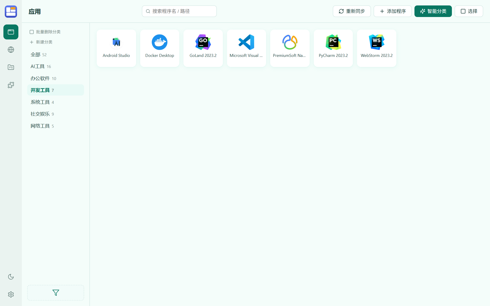
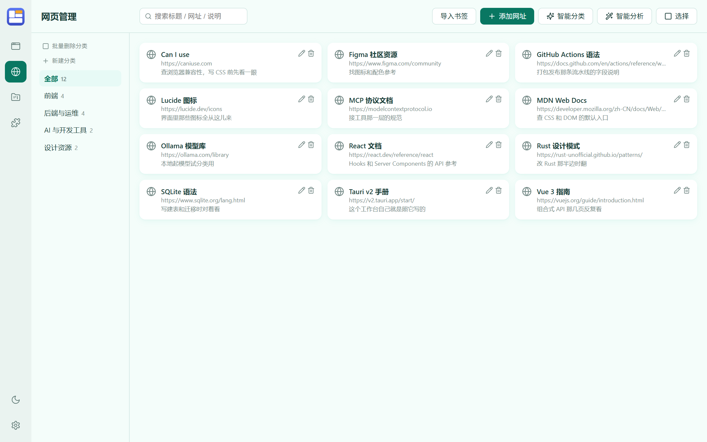
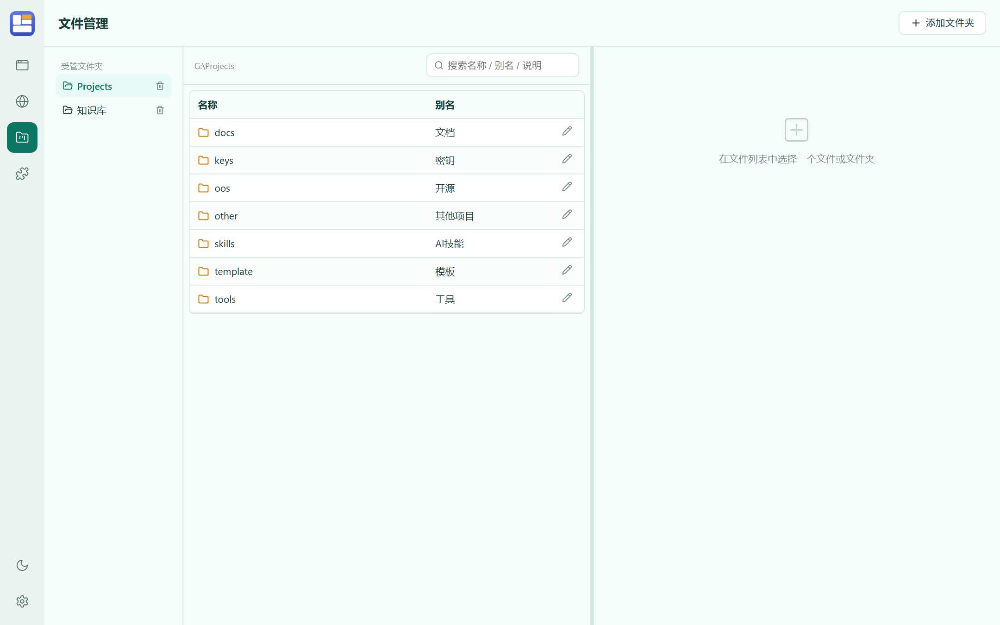
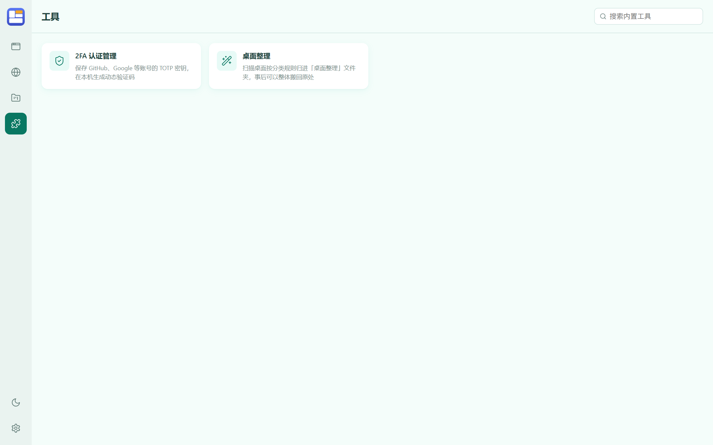
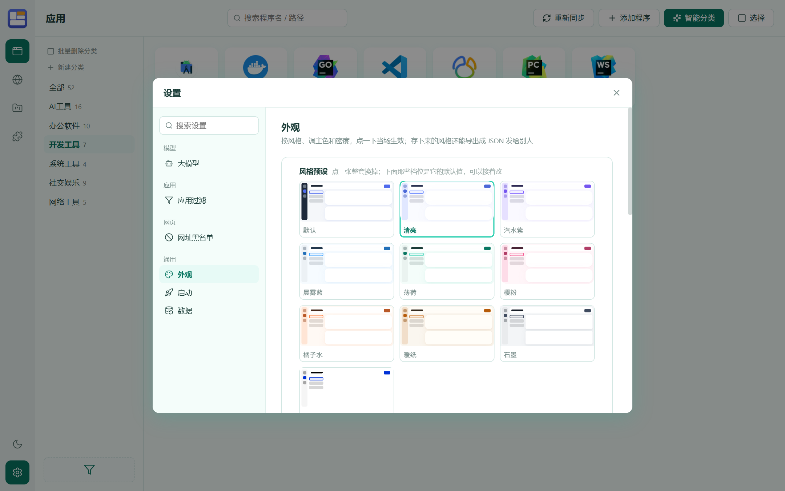

# 个人工作台



Windows 单机自用工作台。要解决的就两件事：**快速打开**应用和网页，以及**防止忘记**——忘了自己装过什么、收藏的网址当初为什么收、桌面上那个文件是干嘛的。

Tauri 2 + React 18 + Rust + SQLite。**没有服务端、没有账号、没有遥测**，所有数据都在本机 `%APPDATA%\workbench\`。

| 页面 | 干什么 |
|---|---|
| [文件](#文件打开就是这页) | 翻整台机器 + 别名说明 + 不装 Office 也能预览 |
| [应用](#应用) | 本机装了什么照一遍镜子，双击启动，常用的排最前 |
| [网页](#网页) | 书签库，外加「这个网址是干嘛的」的智能分析 |
| [工具](#工具) | 2FA 认证管理、桌面整理 |

再外面是一个**顶边抽屉**（屏幕顶边划一下，左边全部应用、右边全部网址，能打字能直接开）和一个**设置**窗口。

## 三条底线

- **只增不改**：你改过的名字、手动归好的分类、抽好的图标，一次同步都不会抹掉。删卡片只是把它从这一页拿走，不卸载软件。
- **不点就不联网**：只有你主动按「抓取 / 搜索 / 分析 / 拉模型列表」才发请求；**发给模型的只有名字和网址，不带任何本地路径**。
- **卸载不删数据**：库和设置还在 `%APPDATA%\workbench\`，重装接着用；要清干净自己删那个目录。

## 装上就能用

到 [Releases](../../releases) 下其中一个（文件名以 `workbench_` 开头：GitHub 会抹掉资产名里的非 ASCII 字符，所以安装包不带中文产品名，装出来的程序名、开始菜单项还是「个人工作台」）：

- **`workbench_*_x64-setup.exe`** —— 单文件安装程序，双击装；静默安装加 `/S`。
- **`workbench_*_x64_zh-CN.msi`** —— Windows Installer 包，`msiexec /i 包名.msi /qn` 可以无人值守部署。

装机需要 Microsoft Edge WebView2 运行时（Win10 1803+ 和 Win11 自带）。

**同时只跑一个实例**：窗口收进托盘后再双击图标，不会开出第二个窗口，而是把在跑的那个叫到眼前。

从源码跑、以及怎么打包，看 [CONTRIBUTING.md](CONTRIBUTING.md)。

> 下面括号里的数字都是**本机一次实测**，换一台机器会不一样。这台机器的现状：52 张应用卡片、299 条书签、67 条自定义过滤模式、53 条分类记忆、783 条桌面整理流水。

## 应用

进这页就读两遍本机。

**第一遍是注册表**——`HKLM` 和 `HKCU` 的 `...\CurrentVersion\Uninstall`，32 位和 64 位两份视图都算上（本机实测读出 352 条卸载项）。这是 Windows 自己记「装了什么」的地方，所以带得到**发行商和版本**（在卡片的编辑框里能看到）。

**第二遍补开始菜单**里注册表没记的东西——商店应用和没跑过安装程序的绿色版，实测多收 20 个（Git Bash、IDLE、WSL、OpenSSL 命令行都在里面）。

系统组件、补丁、更新程序、运行库、厂商驱动、`.NET` / DirectX / WebView2 这类运行环境默认不收（**设置 → 应用过滤**：实测 454 条候选里挡掉 272 条、最后收 93 个）。自己装来用的不算在里面，Python、Node.js、GoLand 照常收。

### 怎么打开它：六级查找

注册表说不准「怎么打开」，所以目标按六级找：`DisplayIcon` 里那个真存在的 exe → `DisplayIcon` 指的是快捷方式的 → 开始菜单里同名的快捷方式 → 安装目录自己就是 exe → 已知那几个目录（安装目录、卸载器所在目录、`DisplayIcon` 所在目录，各自再往上退一层、往隔壁子目录看一层）里名字对得上的 exe → 卸载串里那个不是卸载器的 exe；全落空就用目录本身（点开是文件夹）。

卸载器、`ProgramData\Package Cache` 里那种重装外壳一律不当目标，**0 字节的空壳也不当**——WPS 自更新留下的 `ksolaunch.exe` 就是这样，点上去没反应，真身是隔壁 `office6\wps.exe`。什么路径都没有的那些不收卡片，只在同步的回话里报个数（本机实测 17 条：GitHub CLI、Go、OpenSSL、Nsight、UE4 Prerequisites 这类 MSI 条目，卸载串只写 `MsiExec.exe /X{GUID}`，注册表里一个字都没说程序在哪）。

### 判「是不是同一个程序」只看名字

**不看目标文件**。因为一个启动器养一片程序的情况太多：Steam 每个游戏的 `DisplayIcon` 都是 `steam.exe`，按文件去重会只剩一张——**Steam 自己就是这么没的**。

判重只看名字：完全一样，或者去掉标点后一个是另一个的一段（短于四个字的段不算，`Git` 不会把 `GitHub CLI` 吞掉）。桌面上那 60 张老卡片一张不少，跟注册表读出来的程序并排显示，也不会多出第二张。

### 用法

- 卡片**双击**才启动（键盘上 Enter 等价于那一下双击），卡片和分类树都按打开次数排——常用的自然浮到前面。
- 卡片可以直接拖到左边的分类树上归类；分类树就地新建、改名、删除，**改名会连带改同名的分类规则和 `桌面\桌面整理\<分类>` 那个目录**。
- 不想要的卡片**拖到分类栏底下那个过滤图标上**——名字进过滤名单、卡片当场消失，不用去设置里照着名字手打。
- 这一页是「本机装了什么」的镜子：删卡片不卸载软件，下次同步照样收回来；要它别再出现就用上面那个拖来过滤。**手动点的重新同步一定给回话**（有新收录报条数和被挡的个数，没有就报「当前 N 个」）。
- 卡片上没有按钮也没有右键菜单，勾选和批量删除走顶栏的「选择」。
- **添加程序**手填一条，exe、lnk、网址都能当目标。
- 图标取的是「桌面上看到的那张」：同名快捷方式、`DisplayIcon`、真目标按这个先后试，抽到就缓存下来，不重复抽。

### 智能分类：说实话它有点笨

按 **本机记忆 → 大模型 → 联网搜索** 的顺序判，判过一次就记进本机记忆（这台机器攒了 53 条），下次不再花钱。默认只判「未分类」和落在「其他」里的项。

它笨是有原因的：**发过去的往往只有一个程序名**，本地路径那些不外发，它只能靠名字猜，遇到 `xxx-setup.exe` 这种就懵。但判错了你手改一下，改完它就一直听你的。分类规则不掺这边的事——它只管桌面上文件挪去哪个文件夹。

## 网页



书签库 + 同一套分类树和智能分类。加网址三条路：**从浏览器导入收藏夹**、手填、编辑现有条目。

**智能分析**：开窗只告诉你「这批 N 条」，按「开始分析」才发请求。顺序是——先看本机缓存，再抓页面的 title/description（GitHub 走它的 API，比抓网页稳），都拿不到才交给模型。一轮最多抓 40 个网页、GitHub 60 次，撞额度就本轮收手，再点一次只补没排到的。

**每行都标着结论是从哪儿来的**：抓到的写抓到，缓存的写缓存，模型猜的明写「模型猜·未抓」。换分类或改搜索词再点，分析的就只是筛出来的这一批。

判出来的重复条目默认帮你勾上要删的；删掉的不真删，进回收站能捞回来。

## 文件（打开就是这页）



这页现在就是本机的资源管理器：**整台机器都能翻**，左边是三节入口——你顶上去的「收藏」、系统的「常用」（桌面/下载/文档/图片/音乐/视频）、以及「此电脑」（每个盘符、U 盘、网络盘）。不再需要先「添加文件夹」登记什么。隐藏和系统项默认不摆出来，侧栏底下那个开关打开才有；「新建分栏」「收藏这里」也收在那里。

**列视图**：点一个文件夹，它右边当场长出一列摆出里面的东西，再点再往右长——资源管理器左边那棵树横过来就是这个样子。双击文件夹则把这个标签整个挪进去，从头开始；双击文件交给系统程序打开。标签条上的 `+` 新开一个文件夹，标签按当前目录取名。地址栏在上、标签栏在下，这一条横跨整个内容区（预览栏从它下面才开始），切到哪一栏就换成哪一栏的地址和标签。地址栏是资源管理器那种面包屑：盘符到当前目录一层一段，点哪一层就回到哪一层（那一列已经开着的话只是把焦点挪过去，右边那几列不收）；点空白处或按 Ctrl+L / Alt+D 变成输入框，整条路径可以直接敲、直接粘。右边那片还能横着切好几栏（侧栏「新建分栏」），每栏自己开标签；栏与栏之间那条缝能拖，各自多宽、开了哪几个文件夹、走到哪个目录，下次进来还是那样。侧栏点哪里都只是「在当前标签里换过去」：桌面、下载、盘符点一下就换，不会叠出新标签；要另开标签用标签条上的 `+`，或把文件夹拖到标签条上。

**图标是系统自己画的**：列表里和侧栏左边那些小图标走 Windows 的 shell 图标接口，认得每种文件类型自己的图标，也认得快捷方式。画好的 png 按路径哈希缓存在 `%APPDATA%\workbench\icons\`，同一个文件只问系统一次；系统给不出来就退回一套线条图标。

**别名和说明是这一页的重点**：每个文件或文件夹可以起一个别名、写一句说明，专门治「这个文件为什么留着」。别名**只存在自己的库里，不改磁盘上的文件名**，跟在文件原名右边；搜索框一个词同时搜名称、别名、说明。

**日常那几个动作都在**：新建文件夹、重命名（F2）、删除到回收站（Delete）、彻底删除（Shift+Delete）、复制/剪切/粘贴（Ctrl+C / Ctrl+X / Ctrl+V）、全选（Ctrl+A）、刷新（F5）、Alt+← / Alt+→ 前后退、Backspace 往上一列收。多选走 Ctrl 加选和 Shift 连选，批量动作都在右键菜单和快捷键里，栏顶不再占一条工具条。**改名或搬走，别名和说明跟着一起走**，不会留在原路径上变成孤儿。

剪贴板走的是**系统那一份**：写进去的是 Windows 的 `CF_HDROP`（外加 `Preferred DropEffect` 说明是复制还是剪切），所以在资源管理器里粘贴是照常复制/移动，在 Outlook 和浏览器里粘贴是加附件；反过来在这几个程序里 Ctrl+C 的文件，切回来也能粘进这里的目录。剪切粘完会照资源管理器的做法把这串标成作废，免得下一次粘贴往已经不存在的路径上做动作。

每个目录列不带头行，排序在右键菜单里：「排序：名称↑」点一次换下一档，名称/大小/时间各自正反；每栏底下那条写着几项、选了几项、这个盘还剩多少。

预览栏**平时收着**，选中一个具体文件才在右边弹出来（选目录、多选、点空白都收起），列区随即占满整宽；开着的时候和列区之间那条缝能拖，宽度照样记住。

预览覆盖：Markdown（GFM、代码高亮、长代码横向滚动、相对路径图片按 md 所在目录找）、纯文本和日志、PDF 与 HTML，以及 **xlsx / xls / docx / doc**——表格和老版 Word 用的是这个仓库里自己写的字节解析层，**不装 Office 也能看**，列宽、合并单元格、日期格式、文本框艺术字都处理。`pptx` 明确不做。

预览是**按需授权**的：浏览到哪都能列出来，但你点着哪个文件，后端才当场允许 webview 读它所在的那一层目录——没点开的盘面不会被渲染代码摸到。

## 工具



目前两个：**2FA 认证管理**和**桌面整理**。加第三个的口子是留着的——`src/tools/<名字>/` 建目录、`registry.ts` 登记一条就完事（详见 [src/tools/README.md](src/tools/README.md)），后面想要什么工具，自己写或者让 agent 写都行。

### 桌面整理

打开这页就扫一次：当前用户桌面 + 公共桌面两个根，连子目录一起往里看两层（`desktop.ini` 和隐藏文件跳过）。左边是按分类规则算出的分类（带计数，点一下筛右边），右边把扫出来的桌面项铺成卡片、每张底下写着它要去哪个分类。

- **一键整理**：重扫一遍，弹一份**逐条确认**。目标分类那个下拉里就是分类规则的那些名字。**只有撞上某条规则的项才会进这份清单**——一条都没撞上的文件不出现，也不会被凭空塞进一个「其他」分类；要管它就去加一条规则。
- 确定后**勾了「移动」的那几项**才搬进 `桌面\桌面整理\<分类>`，同名自动加 `(1)(2)`；没勾的原地不动，也不记进整理流水（表头那个勾是全选/全不选，默认全勾）。
- **恢复整理**：把搬进「桌面整理」的文件原路搬回桌面，被搬空的分类目录一并收掉。
- **分类规则**：归档依据就这一张表——目标分类名、关键词、扩展名、排序、开关。**关键词优先于扩展名**。改了规则里的分类名，会连 `桌面\桌面整理\<分类>` 那个目录一起改名（目录里的文件跟着走，「恢复整理」照样能用）；新名字撞上已有分类或已有目录会**直接拒绝，不会悄悄合并**。
- 整理**只搬文件、只记自己的流水**，不往「应用」页登记任何东西——桌面上什么文件都有，塞进启动器会把那一页污染掉。扫描还会**跳过工作台自己**，开发版和装机版路径不同也认得出。

### 2FA 认证管理

TOTP 动态码在本机算。加账户四个入口：截图扫描（抓屏识二维码）、图片识别（Ctrl+V 粘贴）、手动输入、文本导入（批量）。密钥用当前 Windows 用户的 **DPAPI** 加密。

配套的**加密备份**用口令加密导出账户文件（PBKDF2 + AES-GCM）——这是整套东西里唯一能换机使用的文件。口令错了不报错，只会让你解不开，所以别忘。

## 设置



侧栏底部弹出的窗口，左边分组导航 + 顶部搜索，右边一行一个设置项。

| 分组 | 里面有什么 |
|---|---|
| 大模型 | 自己填 OpenAI 兼容接口（显示名、地址、模型名、key），能拉远端模型列表点选、能测连通。不配也能用，只是少掉 AI 那一步。外加三样本机 AI 数据：调用日志、本机记忆、网页缓存，都能清 |
| 应用过滤 | 读注册表同步时跳过哪些程序。**过滤系统应用、驱动和运行环境**默认开：注册表里明写自己是系统组件的、挂在别的程序底下的补丁、名字带 更新程序 / 运行库 / redistributable 的附属程序、驱动包（名字里有 driver / 驱动 / chipset / ODBC 的）、运行环境（`.NET`、DirectX、WebView2 这类给别人用的底座），以及装在 Windows 目录里的（含商店应用 `WindowsApps`）。自己装来用的开发工具不算环境：Python、Node.js、GoLand 照常收。MSI 软件的图标虽然住在 `C:\Windows\Installer`，那不算系统应用。也能自己加模式——一条就是个小写子串，程序名、安装路径或注册表键名里含它就挡。下面有**试算**：拿当前名单重扫一遍，只报数不写库，并列出被挡的名字。名单只影响同步，已经收进来的卡片不会被删 |
| 网址黑名单 | 精确地址（多选拉黑）或域名及其所有子域（手输） |
| 启动 | **开机自启**（写在当前用户的注册表启动项里）、**关闭时放入系统托盘**（**默认开**：点关闭键只是隐藏，托盘图标左键或右键菜单里的「显示主窗口」唤回；关掉的话一关就是真退出）。原来的**唤醒快捷键**已经整条拆掉了——全局热键在这台机器上不是被微信占就是被输入法占，装不上还要每次启动报一句，唤回窗口走托盘图标 |
| 外观 | 十套风格预设（默认、清亮、汽水紫、晨雾蓝、薄荷、樱粉、橘子水、暖纸、石墨、高对比），外加明暗、主色、圆角、密度、文字浓度、阴影、染力度各自可调可存。颜色只有三个地方：`styles/seeds.ts` 出种子、`styles/derive.ts` 算派生变量、界面只读变量名。**高对比那套是无障碍退路**——轻盈是选择，看得见不是 |
| 数据 | 导出整个库 / 从备份文件恢复 |

## 数据与隐私边界

```
%APPDATA%\workbench\workbench.db      唯一的库：分类、程序、书签、文件、整理记录、规则、模型、2FA、记忆、使用计数
%APPDATA%\workbench\workbench.db-wal  和主库同目录，手工备份要一起拷
%APPDATA%\workbench\icons\            图标缓存，删了会重抽
%APPDATA%\workbench\ai.log            AI 调用日志，不含密钥
```

只有你主动点「抓取 / 搜索 / 分析 / 拉模型列表」的时候才联网；发给模型的内容不含本地路径；2FA 密钥和模型 key 换机换用户都解不开，只有 2FA 的加密备份文件能带走。

## 许可

[MIT](LICENSE)。
